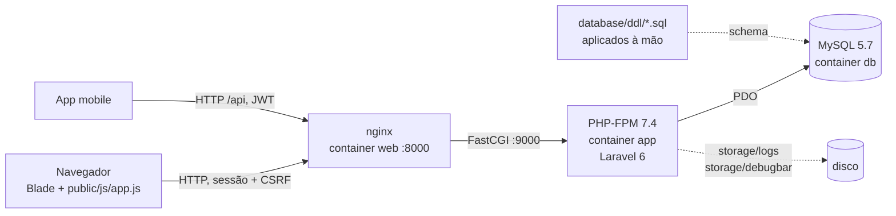
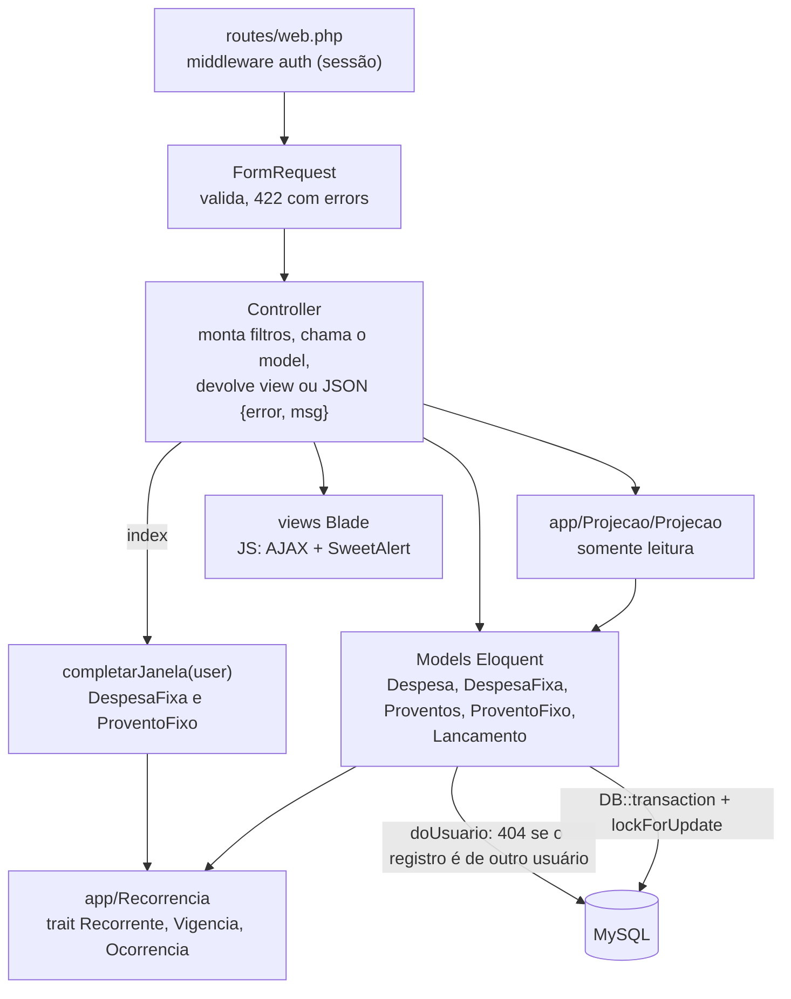
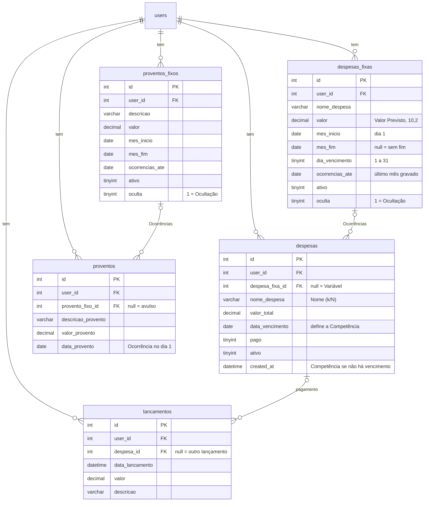
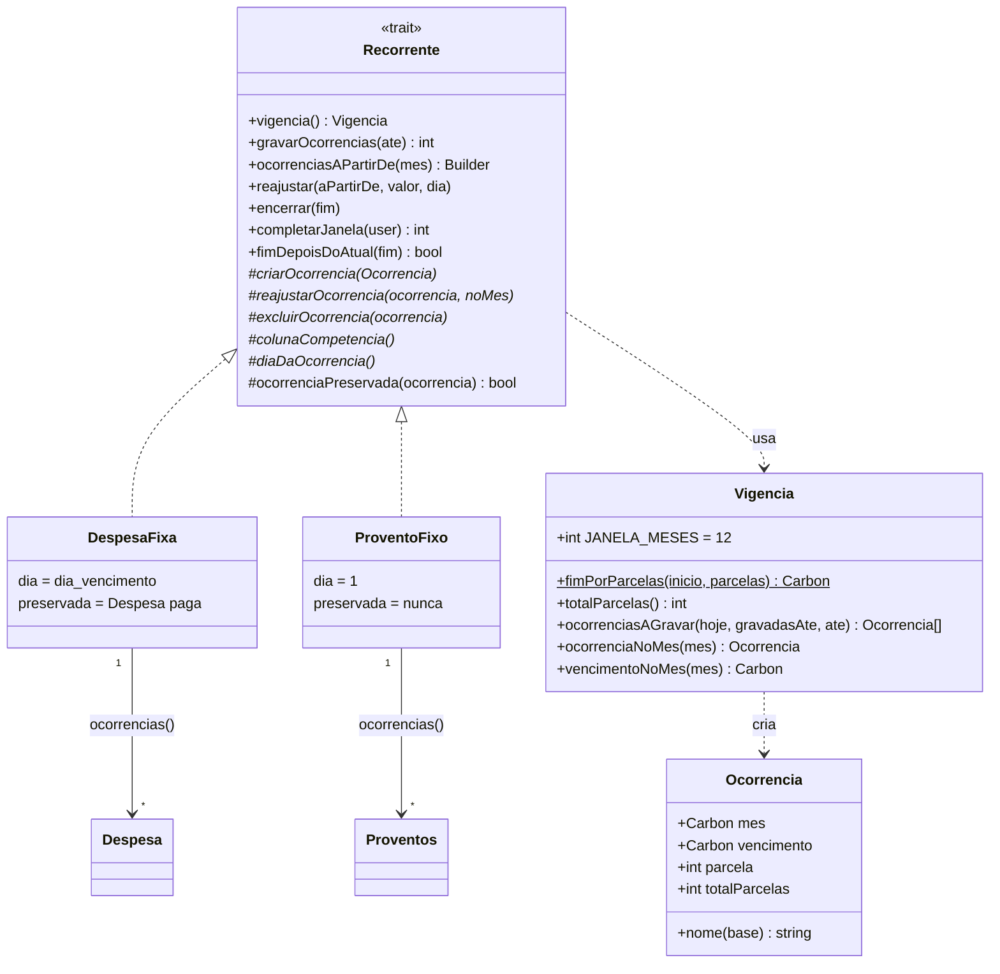
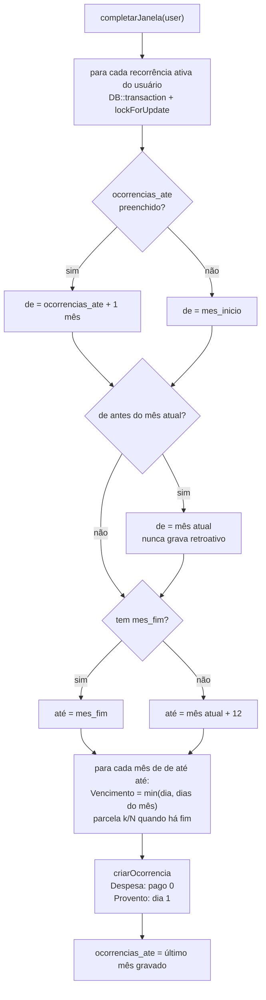
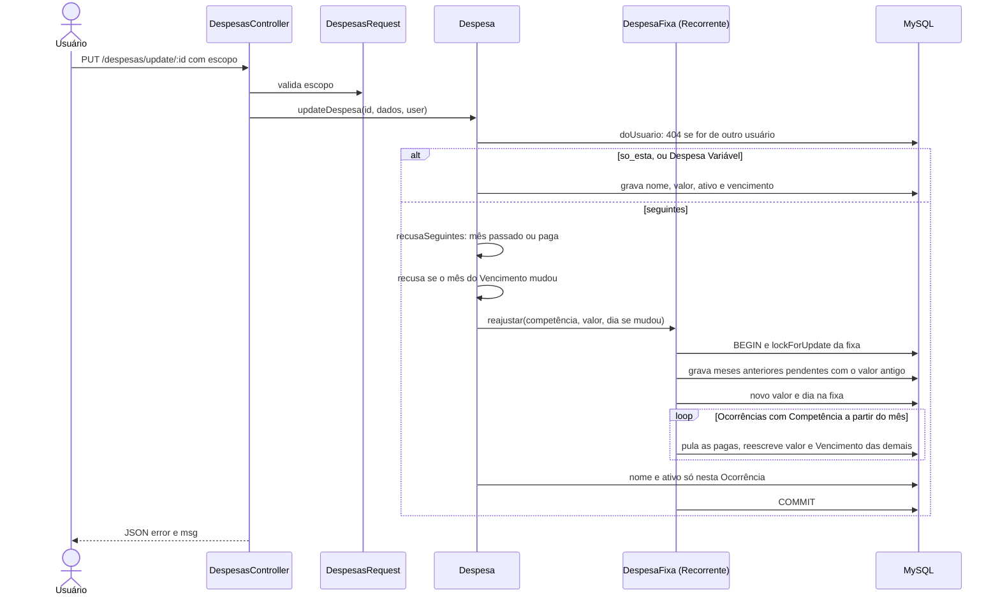
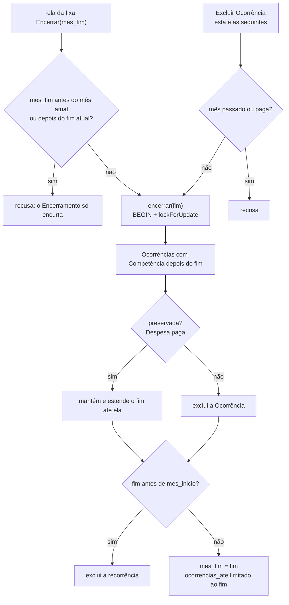
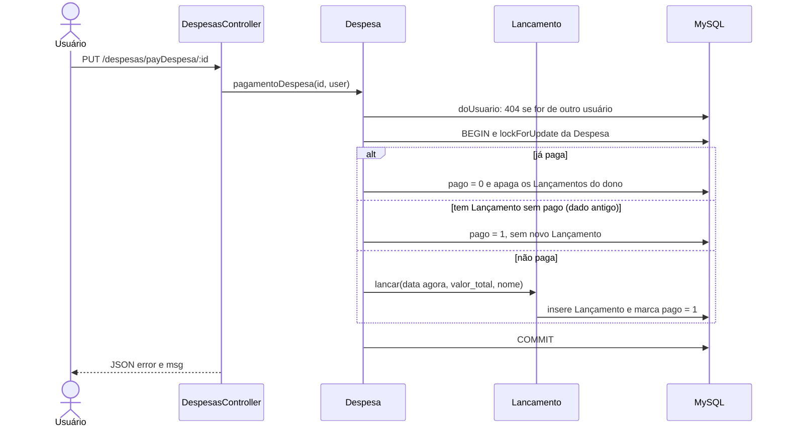
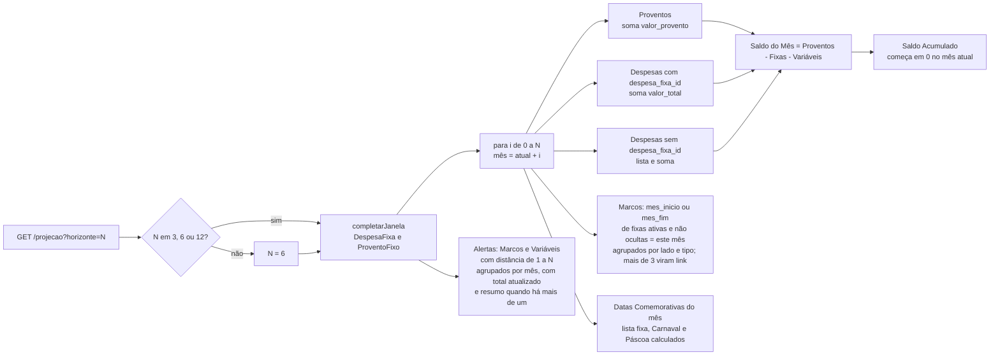

# Jefin Finances: arquitetura, fluxos e regras

## 1. Contexto e stack

Monólito Laravel com views Blade e JavaScript compilado pelo laravel-mix. Há uma API JWT usada pelo app mobile, com escopo menor que o da web. Não há filas, cache de aplicação nem jobs agendados: a janela de Ocorrências é completada quando o usuário abre uma tela.

PHP 7.4 (FPM) · Laravel 6.20 · MySQL 5.7 · nginx 1.29 · Blade + jQuery + SweetAlert · laravel-mix 5 / Node 14 · tymon/jwt-auth · PHPUnit + SQLite `:memory:` · Docker Compose (web, app, db)



O schema real vem dos arquivos em `database/ddl`, sem migrations. Os testes usam um schema próprio em `tests/migrations`.

## 2. Camadas da requisição

Os controllers são finos. As regras de negócio, as transações e a checagem de dono ficam nos models e nos módulos `app/Recorrencia` e `app/Projecao`. Escritas respondem JSON `{error, msg}`; falhas inesperadas são registradas no log e viram mensagem genérica.



## 3. Modelo de dados

Toda tabela de domínio pertence a um `user_id`. Ocorrências são linhas comuns de `despesas` e `proventos` com a chave da recorrência preenchida (`despesa_fixa_id`, `provento_fixo_id`); Despesas Variáveis e Proventos avulsos têm essa chave nula.

Uma Despesa é só Fixa ou Variável: `despesas_tipos`, `despesa_tipo_id` (agora nulo) e `dividas` continuam no banco, mas as telas não os usam mais (só a API ainda expõe os Tipos de Despesa).



Valores monetários em `DECIMAL(10,2)`. As tabelas `valor_hora` e `dividas` existem no banco mas não são usadas pelo código.

**Ocultação.** `oculta = 1` numa fixa esconde ela e todas as suas Ocorrências de todo o app. Um global scope (`App\Recorrencia\SemOcorrenciasOcultas`) em `Despesa` e `Proventos` tira das consultas as linhas cuja recorrência está oculta; só a relação `ocorrencias()` da própria fixa o ignora, para Encerrar e Excluir continuarem funcionando. Fixa oculta não grava Ocorrências novas; ao desocultar, a janela se completa.

## 4. Módulo Recorrência

`Vigencia` é um objeto de valor puro: decide quais meses gravar e calcula Vencimento e parcela, sem tocar no banco. O trait `Recorrente` concentra gravar, Reajuste e Encerramento; cada model informa como criar, reajustar e excluir a sua Ocorrência.



## 5. Gravação de Ocorrências

É chamada pelo `index` de Despesas, Despesas Fixas, Proventos, Proventos Fixos e Projeção, e no cadastro da fixa. É idempotente: abrir a tela de novo no mesmo mês não grava nada. Cada recorrência é travada na sua própria transação, para que duas abas abertas não gravem o mesmo mês duas vezes.



Como a gravação parte de `ocorrencias_ate` e não dos meses existentes, uma Ocorrência excluída com "só esta" não é recriada.

## 6. Alteração de Ocorrência com escopo

Na Despesa o escopo vem do campo `escopo` (`so_esta` ou `seguintes`); no Provento, de `update_subsequent`. "Esta e as seguintes" vira um Reajuste da fixa a partir da Competência da Ocorrência. Nome e ativo continuam valendo só para a Ocorrência editada.



O dia só é repassado ao Reajuste quando difere do Vencimento calculado; assim, um dia 31 cortado para 30 num mês curto não muda o dia da fixa.

## 7. Encerramento

Tem duas entradas: a ação "Encerrar" na tela da fixa (`PUT …/encerrar/:id`, com o mês de fim) e a exclusão de uma Ocorrência com "esta e as seguintes", que chama `encerrar(competência − 1 mês)`.



## 8. Pagamento de Despesa

O botão é um toggle. O `pago` da Despesa e o Lançamento mudam na mesma transação, e a Despesa é relida com trava para que dois cliques simultâneos não lancem dois pagamentos.



Excluir uma Despesa paga leva junto os Lançamentos do dono (`excluirComLancamentos`, issue #16).

## 9. Projeção

Somente leitura sobre os registros gravados. Antes de ler, o controller completa a janela das recorrências, para que o último mês do Horizonte de 12 já tenha as fixas sem fim.



Competência das Despesas: `COALESCE(data_vencimento, created_at)`. O nome no Marco de término é o da Ocorrência gravada no mês de fim, por exemplo "Cartão (4/10)" após um Encerramento antecipado.

No Alerta de um Marco, o total atualizado é o de Despesas Fixas (ou de Proventos) gravado no mês em que o Marco faz efeito: o próprio mês, quando começa; o mês seguinte, quando termina (o mês de fim ainda conta a última Ocorrência). O resumo do mês soma os Alertas de ganho (entra) e de atenção (sai).

## 10. Regras de negócio

Cada regra tem um id estável para ser citado em issues e PRs. "Garantida em" aponta onde o código a impõe; "Teste" aponta a classe de Feature que a cobre.

| Id | Regra | Garantida em | Teste |
|---|---|---|---|
| RN-01 | Todo registro é do seu usuário. Ler, alterar, excluir, ocultar ou pagar um registro de outro usuário responde 404. | `Model::doUsuario (Despesa, Proventos, Lancamento, fixas)` | DonoDaDespesaTest, DonoDoLancamentoTest, OcorrenciaProventoFixoEscopoTest, OcultacaoTest |
| RN-02 | A Competência de uma Despesa é o mês do Vencimento; sem Vencimento, o mês de cadastro. | `Despesa::getDespesas, Despesa::competencia` | VencimentoDespesaTest |
| RN-03 | Ocorrências são gravadas antecipadamente até o mês atual + 12, só depois da última gravada e nunca em meses passados. | `Vigencia::ocorrenciasAGravar, Recorrente::completarJanela` | DespesaFixaVigenciaTest, ProventoFixoTest, ProjecaoTest |
| RN-04 | O Vencimento de cada mês é o dia da fixa, ou o último dia do mês quando ele é mais curto. | `Vigencia::vencimentoNoMes` | DespesaFixaVigenciaTest |
| RN-05 | Parcelas: fim = início + N − 1; cada Ocorrência recebe o nome "Nome (k/N)". Informar parcelas e mês de fim juntos responde 422. | `Vigencia::fimPorParcelas, Ocorrencia::nome, DespesasFixasRequest` | DespesaFixaVigenciaTest |
| RN-06 | Uma Despesa é só Fixa ou Variável: não há Tipo de Despesa nas telas, e Despesas e fixas são gravadas sem tipo. | `DespesasRequest, Despesa, DespesaFixa` | DespesaSemTipoTest |
| RN-07 | "Esta e as seguintes" é recusado num mês passado, numa Ocorrência paga e quando o mês do Vencimento muda. | `Despesa::recusaSeguintes, Despesa::updateDespesa, Proventos::updateProvento` | OcorrenciaDespesaFixaEscopoTest, OcorrenciaProventoFixoEscopoTest |
| RN-08 | Reajuste: os meses anteriores ainda não gravados ficam com o valor antigo; do mês em diante, sobrescreve também os ajustados à mão, menos os pagos. | `Recorrente::reajustar` | OcorrenciaDespesaFixaEscopoTest |
| RN-09 | Encerramento só encurta e não aceita mês passado. Ocorrências pagas são preservadas e estendem o fim até elas; fim antes do início exclui a recorrência. | `Recorrente::encerrar, fimDepoisDoAtual, requests das fixas` | OcorrenciaDespesaFixaEscopoTest, ProjecaoTest |
| RN-10 | Excluir uma Despesa Fixa apaga ela e todas as Ocorrências, só enquanto nenhuma foi paga; com alguma paga, use Encerrar. | `DespesaFixa::deleteDespesaFixa` | DespesasFixasTelaTest |
| RN-11 | Pagamento é atômico: `pago` e Lançamento mudam juntos. Excluir Despesa paga apaga os Lançamentos do dono. | `Despesa::pagamentoDespesa, Lancamento::lancar, excluirComLancamentos` | ConsistenciaDespesaLancamentoTest |
| RN-12 | Projeção: Horizonte em {3, 6, 12} (outro valor vira 6); Saldo Acumulado parte de zero; Marcos incluem o mês atual; Alertas só para distância ≥ 1. | `Projecao::horizonteValido, meses, alertas` | ProjecaoTest |
| RN-13 | Valores de Despesa, fixas, Lançamento e Provento até `DECIMAL(10,2)` (R$ 99.999.999,99). | `DDL valores_ate_99_milhoes.sql, provento_fixo.sql` | smoke no MySQL (PR #20) |
| RN-14 | O guia do usuário é público em `/guia` e tem link na tela de login. | `routes/web.php, auth/login.blade.php` | GuiaDoUsuarioTest (PR #23) |
| RN-15 | Ocultação: a fixa oculta e todas as suas Ocorrências, inclusive pagas, somem de listas, totais, Projeção, Marcos e Alertas, sem nada ser alterado; desocultar restaura tudo. | `SemOcorrenciasOcultas, Recorrente::ocultar, completarJanela` | OcultacaoTest |
| RN-16 | Comprometimento da Renda com Despesas Fixas = Valor Previsto das fixas vigentes ÷ Proventos do mês atual (sem Proventos, não é calculado). | `DespesasFixasController::index` | DespesasFixasTelaTest |
| RN-17 | A tela inicial depois do login é a Projeção; `/home` redireciona para ela. | `RouteServiceProvider::HOME, routes/web.php` | MenuTest |

## 11. Rotas de domínio (web)

Todas sob o middleware `auth`, exceto login, cadastro, recuperação de senha e `/guia`. Cada recurso segue o padrão `index · create · store · edit · update · delete`; a tabela lista as rotas que fogem dele.

| Método | Caminho | Faz |
|---|---|---|
| GET | `/despesas?mes&ano` | Despesas do mês; completa a janela antes |
| PUT | `/despesas/update/:id` | Edita; `escopo=so_esta\|seguintes` numa Ocorrência |
| DELETE | `/despesas/delete/:id` | Exclui com Lançamentos; `seguintes` encerra a fixa |
| PUT | `/despesas/payDespesa/:id` | Toggle de pagamento (RN-11) |
| PUT | `/despesasFixas/reajustar/:id` | Reajuste a partir de `a_partir_de` (≥ mês atual) |
| PUT | `/despesasFixas/encerrar/:id` | Encerramento em `mes_fim` |
| PUT | `/despesasFixas/ocultar/:id` | Ocultação: `oculta=1` oculta, `oculta=0` desoculta |
| DELETE | `/despesasFixas/delete/:id` | Exclui a fixa e todas as Ocorrências, se nenhuma estiver paga (RN-10) |
| PUT | `/proventosFixos/reajustar/:id` | Reajuste do Provento Fixo |
| PUT | `/proventosFixos/encerrar/:id` | Encerramento do Provento Fixo |
| PUT | `/proventosFixos/ocultar/:id` | Ocultação do Provento Fixo |
| PUT | `/proventos/update/:id` | Edita; `update_subsequent` vira Reajuste |
| DELETE | `/proventos/delete/:id` | `delete_subsequent` vira Encerramento |
| POST | `/proventos/copyProventos` | Copia os Proventos avulsos do usuário do mês anterior para o mês do filtro |
| GET | `/projecao?horizonte` | Projeção, Marcos, Alertas e Datas Comemorativas; tela inicial |
| GET | `/guia` | Guia do usuário, público |

A API (`routes/api.php`, middleware `verifyApi` com JWT) expõe usuários, Tipos de Despesa, Lançamentos (só leitura) e Proventos. Ela não tem Despesas, fixas nem Projeção.

## 12. Testes

Testes de Feature pelas rotas HTTP, com `RefreshDatabase` sobre SQLite em memória. A data é fixada com `Carbon::setTestNow`; as falhas são simuladas com eventos de model que lançam exceção.

> **Trava obrigatória.** `tests/TravaBancoDeTeste.php` aborta a suíte se a conexão resolvida não for SQLite `:memory:`. O `RefreshDatabase` apaga todas as tabelas da conexão, e isso já destruiu o banco de dev uma vez. Rode no container:
>
> ```sh
> docker exec jefin_finances_app sh -c 'cd /var/www && php artisan config:clear && vendor/bin/phpunit'
> ```

- Estado atual: 140 testes, 761 asserções.
- Não cobertos: as travas `lockForUpdate` (o SQLite as ignora), o JavaScript das telas e o dark mode (sem testes de navegador) e Usuários.
- Schema de teste: `tests/migrations/2026_11_21_000001_criar_schema_de_teste.php`. Ao mudar um DDL, atualize os dois.

## 13. Dívida técnica conhecida

| Gravidade | Item | Detalhe |
|---|---|---|
| alta | Usuários sem checagem de dono | O model de Usuários não aplica RN-01 nem registra falhas no log. |
| média | Schema por DDL manual | Sem migrations: cada ambiente aplica `database/ddl` na ordem certa, e o schema de teste é mantido à parte. Divergência entre os dois passa despercebida. |
| média | Concorrência e JS sem testes | As travas só funcionam no MySQL e não são exercitadas pela suíte; as telas não têm teste de navegador. A Ocultação depende de um global scope: consultas novas em `Despesa`/`Proventos` já o recebem, mas um `withoutGlobalScopes()` esquecido reexibe Ocorrências ocultas. |
| baixa | Debugbar com chave duplicada | `config/debugbar.php` define `storage.enabled` duas vezes; sem `DEBUGBAR_STORAGE_ENABLED=true`, requisições AJAX estouram o buffer do nginx (502). |
| baixa | Tabelas órfãs e guia manual | `valor_hora`, `dividas` e `despesas_tipos` (fora da API) não são usadas pelo código. O guia do usuário é HTML estático e precisa ser atualizado quando uma regra muda. |
